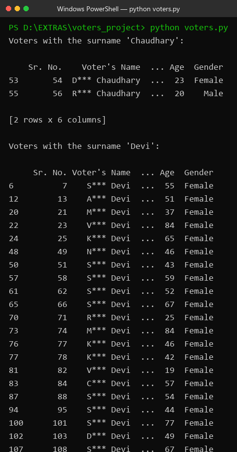
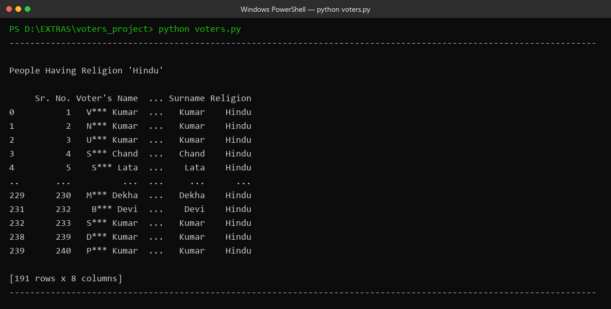
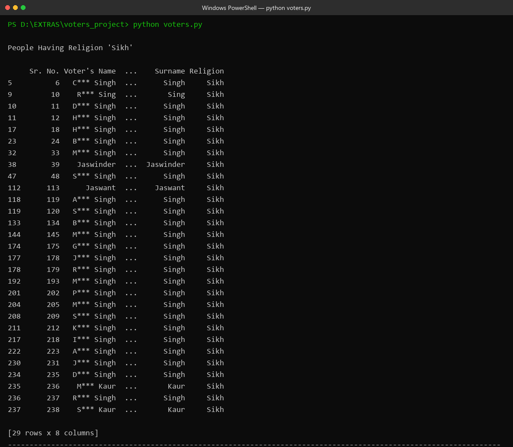
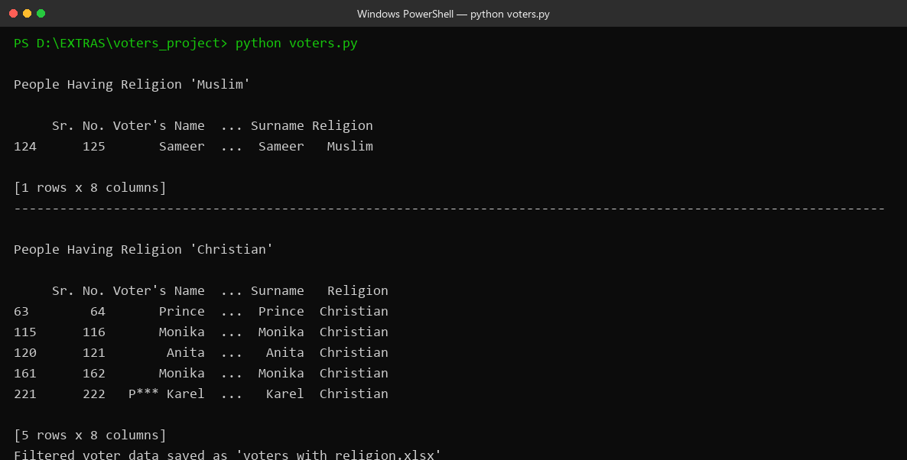

# 🗳️ Voter Classifier

A Python-based data analysis tool that processes **voter list data** (Excel format), filters voters by **surname**, and classifies each voter's likely **religion** based on surname/name mapping — all with the power of **pandas**.

---

## 📋 Table of Contents

- [About the Project](#-about-the-project)
- [How It Works](#-how-it-works)
- [Screenshots](#-screenshots)
- [Project Structure](#-project-structure)
- [Requirements](#-requirements)
- [Getting Started](#-getting-started)
- [Input Data Format](#-input-data-format)
- [Output](#-output)
- [Important Notes](#-important-notes)

---

## 🔍 About the Project

This project was built to analyze a voter list (rolled-up polling booth data) where voters need to be grouped by community/religion for analysis purposes. Since the raw voter list does **not** contain a religion column, this tool infers it using a surname-based mapping approach:

1. Reads the voter list from an Excel file.
2. Filters voters matching specific surnames using regex on the voter's name.
3. Extracts each voter's **surname** (last word of the name).
4. Maps the surname to a religion using a predefined dictionary (`religion_map`).
5. Prints grouped results for each religion (**Hindu**, **Sikh**, **Muslim**, **Christian**) and exports the final classified dataset to a new Excel file.

> ⚠️ This is a **heuristic / name-based inference** approach — it is NOT a verified demographic classification. Results are approximations and may contain errors.

---

## ⚙️ How It Works

```
voters.xlsx  ──►  Filter by surname (regex)  ──►  Extract surname
                                                        │
                                                        ▼
                                              Map surname → religion
                                                        │
                                                        ▼
                                    Print religion-wise groups + export Excel
```

**Core logic (from `voters.py`):**

```python
# Filter voters whose name ends with the given surname
def filter_by_surname(df, surname):
    return df[df["Voter's Name"].str.contains(f" {surname}$", case=False, na=False)]

# Extract surname (last word from the name)
df["Surname"] = df["Voter's Name"].str.split().str[-1]

# Map the surname to religion
df["Religion"] = df["Surname"].map(religion_map).fillna("Unknown")
```

---

## 📸 Screenshots

### 1️⃣ Surname-based filtering
The script scans the voter list and pulls out every voter matching a given surname (e.g. `Chaudhary`, `Devi`):



### 2️⃣ Hindu voter classification
Voters whose surname maps to `Hindu` (e.g. *Kumar*, *Devi*, *Chand*, *Lal*) are grouped together:



### 3️⃣ Sikh voter classification
Voters whose surname maps to `Sikh` (e.g. *Singh*, *Sing*, *Kaur*) are grouped together:



### 4️⃣ Muslim / Christian classification & export
Remaining religion groups are printed, and the fully classified dataset is saved to `voters_with_religion.xlsx`:



> 🛡️ **Privacy note:** the screenshots above were generated using **anonymized data** (names masked, addresses hidden). The actual data files are excluded from this repository via `.gitignore`.

---

## 📁 Project Structure

```
voters_project/
│
├── voters.py                      # Main script — filtering + religion classification
├── surnames.py                    # Helper — extracts unique surnames from voter names
├── voters.xlsx                    # Input voter list (local only, git-ignored)
├── filtered_voters.xlsx           # Intermediate filtered data (local only)
├── voters_with_religion.xlsx      # Final classified output (local only)
├── screenshots/                   # App screenshots for this README
├── .gitignore                     # Keeps personal data out of version control
└── README.md
```

---

## 💻 Requirements

| Package   | Purpose                              |
|-----------|--------------------------------------|
| Python 3.8+ | Runtime                            |
| pandas    | DataFrame operations & filtering     |
| openpyxl  | Reading/writing `.xlsx` files        |

```bash
pip install pandas openpyxl
```

---

## 🚀 Getting Started

1. **Clone the repository**
   ```bash
   git clone https://github.com/Akshat-hub7/voter-classifier.git
   cd voter-classifier
   ```

2. **Install dependencies**
   ```bash
   pip install pandas openpyxl
   ```

3. **Add your data** — place your voter list as `voters.xlsx` in the project root (see format below).

4. **Run the script**
   ```bash
   python voters.py
   ```

---

## 📊 Input Data Format

The input file `voters.xlsx` is expected to contain these columns:

| Sr. No. | Voter's Name  | Father's Name / Husband's Name | House Number | Age | Gender |
|---------|---------------|--------------------------------|--------------|-----|--------|

The tool also supports customizing the target surnames by editing the `List_of_surnames` list in `voters.py`.

---

## 📤 Output

- **Console:** surname-wise filtered voter tables + religion-wise grouped voter lists.
- **Excel:** `voters_with_religion.xlsx` — the original data with two new columns:
  - `Surname` — last word of the voter's name
  - `Religion` — inferred religion (`Hindu` / `Sikh` / `Muslim` / `Christian` / `Unknown`)

---

## ⚠️ Important Notes

- **Heuristic method:** surname → religion mapping is an *assumption-based* approach. Many names are shared across communities, so treat all results as **indicative, not definitive**.
- **Privacy:** voter data contains personal information. The `.gitignore` in this repo excludes all `.xlsx` files so that no personal data is ever committed to version control. If you fork or reuse this project, please follow local data-protection regulations (e.g. India's DPDP Act) when handling voter data.
- The `religion_map` dictionary can be extended with more surnames as needed.

---

## 👤 Author

**Akshat Choudhary** — [Akshat-hub7](https://github.com/Akshat-hub7)

## 📄 License

This project is for educational/personal use. Please respect privacy laws when handling voter data.
